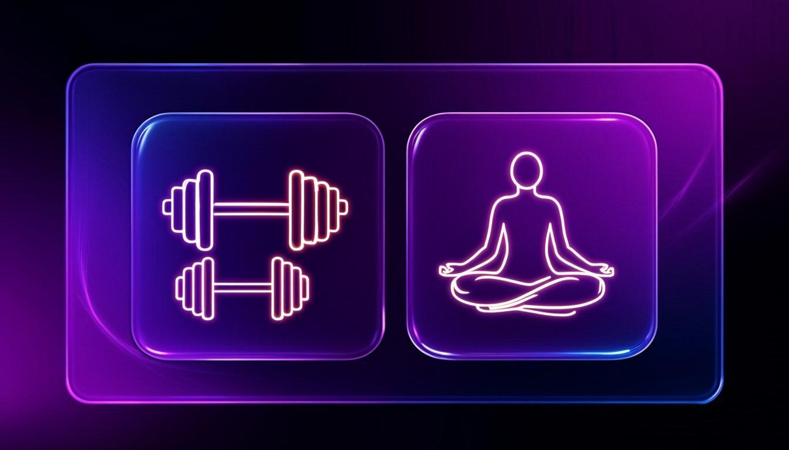
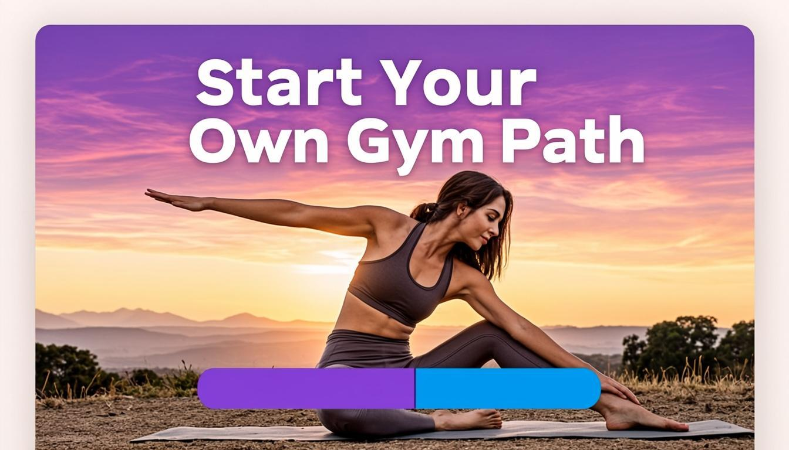
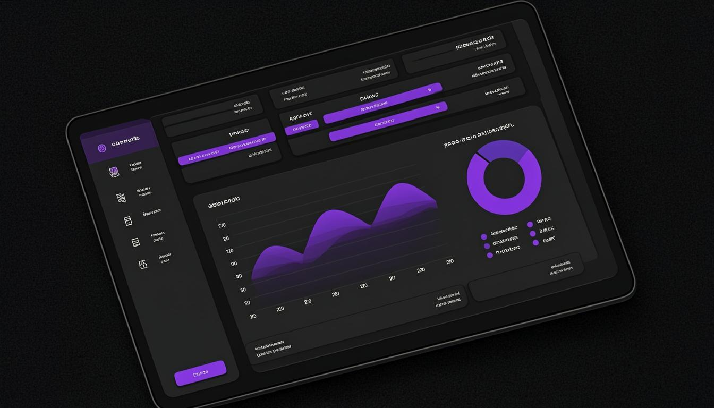

<div align="center">



# 🧘‍♀️ isensi — Fitness & Wellness Platform

### A bilingual (Persian / English) MERN-stack fitness studio web app with role-based dashboard, classes, instructors, articles, cart & checkout.

[](https://www.mongodb.com/mern-stack)
[](https://react.dev)
[](https://vitejs.dev)
[](https://nodejs.org)
[](https://mongodb.com)
[](#license)

[](#)
[](CONTRIBUTING.md)
[](#-internationalization)
[](#-features)

</div>

---

> 💡 **TL;DR** — Clone → `npm install` in both `backend/` and `frontend/` → start MongoDB → `npm start` (backend) → `npm run dev` (frontend) → open <http://localhost:5173>.

---

## 📑 Table of Contents

- [✨ Overview](#-overview)
- [📸 Screenshots](#-screenshots)
- [🚀 Features](#-features)
- [🛠️ Tech Stack](#-tech-stack)
- [📦 Project Structure](#-project-structure)
- [⚙️ Quick Start](#-quick-start)
- [🌐 Environment Variables](#-environment-variables)
- [🌍 Internationalization](#-internationalization)
- [🎨 Color Palette](#-color-palette)
- [📋 API Endpoints](#-api-endpoints)
- [🛣️ Frontend Routes](#-frontend-routes)
- [🔐 Auth Flow](#-auth-flow)
- [🛠️ Notable Fixes](#-notable-fixes-from-original-codebase)
- [🗺️ Roadmap](#-roadmap)
- [🤝 Contributing](#-contributing)
- [📄 License](#license)

---

## ✨ Overview

**isensi** is a full-stack web application for a fitness / yoga studio. It lets visitors browse classes, instructors and articles, register, log in, add classes to a cart, and (in the admin dashboard) manage users, classes and analytics.

The codebase was inherited in a half-broken state and was **fully repaired, refactored and enhanced**. Every page now renders, the dashboard is no longer empty, the gallery uses all images, and the entire UI is bilingual with proper RTL / LTR support.

| | |
|:---:|:---:|
| 🌐 Bilingual UI | Persian (RTL) + English (LTR), switchable from any navbar |
| 🌓 Dual themes | Light / dark mode, persisted per surface (site + dashboard) |
| 📊 Dashboard | 6 stat cards, 3 live charts, recent-activity feed |
| 🛒 Cart flow | Add → list → discount → checkout (Zarinpal-ready) |
| 🔐 Auth | JWT in HTTP-only cookie + Bearer header, role-based access |
| 📱 Responsive | Mobile-first, framer-motion animations |

---

## 📸 Screenshots

<div align="center">

### 🏠 Home Page — Hero Section


### 📊 Dashboard — Admin Overview


</div>

> _The actual running app looks even better — these are AI-generated mockups that approximate the real UI._

---

## 🚀 Features

### 🎨 Frontend
- ⚛️ **React 18** + **Vite 4** + **Redux Toolkit** + **React Router v6**
- 🎨 **MUI v5** (dashboard) + **Tailwind CSS** (marketing pages) — best of both worlds
- 🌍 **Bilingual UI** (Persian / English) with full RTL / LTR support
- 🌓 **Dark / light theme** wired to a Redux store
- 📊 **Recharts-powered dashboard** — stat cards, area / bar / pie charts, recent-activity feed
- 📱 Responsive layouts (mobile-first) with **framer-motion** animations
- 🎬 Splash screen, **BMI calculator**, **FAQ accordion**, **image gallery with lightbox**
- 🔌 Axios instance with interceptors + JWT auto-attach (`useAxiosSecure`)
- 🔔 Toast notifications (react-toastify) and sweetalert2

### 🖥️ Backend
- 🟢 **Express** + native MongoDB driver (`MongoClient`)
- 🔐 **JWT auth** (HTTP-only cookie **and** Bearer header), **bcrypt** password hashing
- ✅ **Joi validation** for users, classes, articles
- 👥 **Role-based access** (`user`, `instructor`, `admin`) via `verifyJWT / verifyAdmin / verifyInstructor`
- 🛠️ CRUD routes for users, classes, articles, cart, payments (Zarinpal), enrollments
- ☁️ **Cloudinary** image upload integration
- 🛡️ Centralised error handler (registered AFTER all routes — was a bug before!)

---

## 🛠️ Tech Stack

<div align="center">

| Category | Technology |
|---|---|
| **Frontend** | React 18 · Vite 4 · Redux Toolkit · React Router 6 · MUI 5 · Tailwind 3 · Framer Motion · Recharts · Swiper · Axios |
| **Backend** | Node.js · Express 4 · MongoDB Native Driver · Joi · JWT · bcrypt · Cloudinary |
| **Tooling** | ESLint · PostCSS · Autoprefixer · Nodemon · Vite HMR |
| **Payments** | Zarinpal (Iranian gateway) |
| **Deployment** | Vercel-ready (`vercel.json` included) |

</div>

---

## 📦 Project Structure

```
fit/
├── 📁 backend/
│   ├── 📁 config/              # cors, jwt, cloudinary, mongoose, db
│   ├── 📁 controllers/         # auth, user, class controllers
│   ├── 📁 middlewares/         # verifyJWT, verifyAdmin, verifyInstructor, errorHandler
│   ├── 📁 models/              # Joi schemas (user, class, article, instructor)
│   ├── 📁 routes/              # authRoutes, userRoutes
│   ├── 📄 .env.example         # copy → .env and fill secrets
│   └── 📄 index.js             # main entry — all routes wired here
│
├── 📁 frontend/
│   ├── 📄 const-config.jsx     # static config: nav, banners, sidebar, gallery
│   ├── 📁 public/              # logos, splash assets, data.json
│   └── 📁 src/
│       ├── 📁 app/store.js             # Redux store
│       ├── 📁 i18n/translations.js     # 🌍 Persian + English strings
│       ├── 📁 features/                # Redux slices
│       │   ├── 📁 auth/                # authSlice + authThunks
│       │   ├── 📁 cart/                # cartSlice + cartThunks
│       │   ├── 📁 classes/             # classesSlice + classesThunks
│       │   ├── 📁 users/               # userSlice + userThunks
│       │   ├── 📁 articles/            # articleSlice + articleThunks
│       │   ├── 📁 theme/               # themeSlice (light/dark)
│       │   └── 📁 language/            # languageSlice (fa/en)
│       ├── 📁 hooks/                   # useAuth, useLanguage, useAxiosFetch, useAxiosSecure
│       ├── 📁 components/              # NavBar, Footer, Sidebar, SectionHeading, Pagination
│       ├── 📁 layout/                  # MainLayout, DashboardLayout
│       ├── 📁 pages/
│       │   ├── 📁 Home/                # Hero, Gallery, FAQ, BMI, Articles
│       │   ├── 📁 Dashboard/           # Dashboard.jsx + admin + user subpages
│       │   ├── 📁 classes/             # Classes listing
│       │   ├── 📁 detailClass/         # Single class detail
│       │   ├── 📁 ArticlesPage/        # Articles listing
│       │   ├── 📁 detailArticles/      # Single article detail
│       │   ├── 📁 PopularClasses/      # Homepage popular classes section
│       │   ├── 📁 cartPage/            # Shopping cart
│       │   ├── 📁 products/            # Products page
│       │   ├── 📁 LoginPage/  📁 Register/  # Auth pages
│       │   ├── 📄 Instructors.jsx      # Instructors grid
│       │   └── 📄 NotFound.jsx         # 404 page
│       └── 📁 routes/router.jsx        # all routes wired here
│
└── 📄 README.md                 # you are here ✨
```

---

## ⚙️ Quick Start

### Prerequisites

| | Required | Recommended |
|---|---|---|
|  | ✓ | 20 LTS |
|  | ✓ | 7.0+ |
|  | ✓ | 10+ |

### 1️⃣ Clone & install backend

```bash
cd backend
npm install
cp .env.example .env       # then edit ACCESS_SECRET and other secrets
npm start                  # nodemon index.js → http://localhost:3000
```

### 2️⃣ Install & run frontend

```bash
cd frontend
npm install
npm run dev                # Vite dev server → http://localhost:5173
```

### 3️⃣ Open the app

🌐 Visit <http://localhost:5173> — the splash screen plays once per session, then the homepage loads.

> The frontend proxies `/api/*` to `http://localhost:3000` (see `vite.config.js`).

---

## 🌐 Environment Variables

### Backend (`backend/.env`)

```ini
PORT=3000
MONGODB_URI=mongodb://localhost:27017
ACCESS_SECRET=change_me_to_a_long_random_string_in_production

# Cloudinary (optional)
CLOUDINARY_CLOUD_NAME=
CLOUDINARY_API_KEY=
CLOUDINARY_API_SECRET=

# Zarinpal payment gateway
ZARINPAL_MERCHANT_ID=00000000-0000-0000-0000-000000000000
ZARINPAL_API_URL=https://api.zarinpal.com/pg/v4/payment/request.json
ZARINPAL_VERIFY_URL=https://api.zarinpal.com/pg/v4/payment/verify.json

NODE_ENV=development
```

### Frontend (`frontend/.env`)

```ini
VITE_API_URL=http://localhost:3000
```

---

## 🌍 Internationalization

The app ships with a complete **Persian + English** translation system.

| File | Purpose |
|---|---|
| `src/i18n/translations.js` | All strings, organized by namespace (`nav`, `home`, `dashboard`, `auth`, `cartPage`, `footer`, …) |
| `src/features/language/languageSlice.js` | Redux slice — keeps `language` + syncs `<html lang dir>` |
| `src/hooks/useLanguage.js` | Hook: `const { t, language, dir, setLanguage, toggleLanguage } = useLanguage()` |

### Usage in any component

```jsx
import useLanguage from '../hooks/useLanguage';

const MyComponent = () => {
  const { t, language, dir } = useLanguage();
  return <h1 dir={dir}>{t('nav.home')}</h1>;   // "خانه" or "Home"
};
```

### Switching language

Both the marketing navbar and the dashboard navbar expose a 🌐 button that toggles between `fa` and `en`. The choice is persisted in `localStorage` and the entire layout flips between RTL and LTR automatically.

---

## 🎨 Color Palette

<div align="center">

| Swatch | Token | Hex | Usage |
|:---:|---|---|---|
| 🟪 | `primary.500` | `#21295c` | Deep blue background |
| 🟪 | `primary.400` | `#4d547d` | Sidebar active |
| 🟨 | `secondary.500` | `#ffd166` | Accent yellow |
| 🟨 | `secondary.300` | `#ffe3a3` | Light accent |
| ⬜ | `grey.0` | `#ffffff` | Light mode bg |
| ⬛ | `grey.900` | `#141414` | Dark mode bg |
| 🟦 | Tailwind `secondary` | `#2E4CFF` | Marketing CTAs |

</div>

---

## 📋 API Endpoints

<details>
<summary><b>🔐 Auth</b></summary>

| Method | Endpoint | Auth | Description |
|---|---|---|---|
| `POST` | `/new-user` | — | Register a new user (forced role: `user`) |
| `POST` | `/login` | — | Login, returns JWT in cookie + body |
| `POST` | `/logout` | — | Clear auth cookie |
| `POST` | `/api/set-token` | — | Issue a JWT for a payload |
| `GET` | `/api/verify-token` | cookie/Bearer | Verify token, return user |
| `GET` | `/protected-route` | JWT | Sample protected route |

</details>

<details>
<summary><b>👥 Users</b></summary>

| Method | Endpoint | Auth | Description |
|---|---|---|---|
| `GET` | `/users?page=&limit=` | JWT | Paginated users list |
| `GET` | `/users/:id` | JWT | Single user |
| `PUT` | `/update-user/:id` | JWT + Admin | Update user |
| `DELETE` | `/delete-user/:id` | JWT + Admin | Delete user |

</details>

<details>
<summary><b>🏋️ Classes</b></summary>

| Method | Endpoint | Auth | Description |
|---|---|---|---|
| `GET` | `/classes` | — | Approved classes (public) |
| `GET` | `/class-manage` | — | All classes (admin) |
| `GET` | `/class/:id` | — | Single class |
| `POST` | `/new-class` | JWT | Create class |
| `PUT` | `/update-class/:id` | JWT + Instructor | Update class |
| `PATCH` | `/change-status/:id` | JWT + Admin | Approve / reject class |
| `GET` | `/approved-classes` | — | Approved classes |
| `GET` | `/popular_classes` | — | Top 6 by enrollment |
| `POST` | `/apply-discount` | — | Apply discount code |

</details>

<details>
<summary><b>🛒 Cart & Payment</b></summary>

| Method | Endpoint | Auth | Description |
|---|---|---|---|
| `POST` | `/add-to-cart` | JWT | Add item to cart |
| `GET` | `/cart-by-email/:email` | JWT | User's cart items |
| `DELETE` | `/delete-cart-item/:classId` | JWT | Remove from cart |
| `POST` | `/create-payment-request` | JWT | Initiate Zarinpal payment |
| `GET` | `/verify-payment` | JWT | Verify Zarinpal callback |
| `GET` | `/payment-history/:email` | — | Payment history |

</details>

<details>
<summary><b>📰 Articles & Instructors</b></summary>

| Method | Endpoint | Auth | Description |
|---|---|---|---|
| `GET` | `/articles?page=&limit=` | — | Paginated articles |
| `GET` | `/articles/:id` | — | Single article |
| `POST` | `/new-article` | — | Create article |
| `PUT` | `/articles/:id` | — | Update article |
| `DELETE` | `/articles/:id` | — | Delete article |
| `GET` | `/instructors` | — | List instructors |
| `GET` | `/popular-instructors` | — | Top 6 instructors |

</details>

<details>
<summary><b>📊 Admin & Misc</b></summary>

| Method | Endpoint | Auth | Description |
|---|---|---|---|
| `GET` | `/admin-stats` | JWT + Admin | Dashboard stats |
| `GET` | `/enrolled-classes/:email` | JWT | User's enrolled classes |
| `POST` | `/as-instructor` | — | Apply as instructor |

</details>

---

## 🛣️ Frontend Routes

| Path | Page | Auth |
|---|---|---|
| `/` | Home (hero + gallery + popular classes + articles + BMI + FAQ) | — |
| `/instructors` | Instructors grid | — |
| `/classes` | Classes listing with pagination | — |
| `/class/:id` | Single class detail with discount | — |
| `/articles` | Articles listing | — |
| `/articles/:id` | Single article (reading view) | — |
| `/products` | Products grid | — |
| `/cart` | Shopping cart | ✓ |
| `/login` | Login page | — |
| `/register` | Register page | — |
| `/dashboard` | Dashboard home (stats + charts) | ✓ |
| `/dashboard/users` | Manage users | ✓ Admin |
| `/dashboard/classes` | Manage classes | ✓ |
| `/dashboard/payments` | Payments | ✓ |
| `/dashboard/workout-plans` | Workout plans | ✓ |
| `/dashboard/diet-plans` | Diet plans | ✓ |
| `/dashboard/articles` | Articles management | ✓ |
| `/dashboard/daily-reports` | Daily reports | ✓ |
| `/dashboard/monthly-reports` | Monthly reports | ✓ |
| `/dashboard/analytics` | Analytics | ✓ |
| `/dashboard/admin` | Admin panel | ✓ Admin |
| `/dashboard/settings` | Settings | ✓ |
| `*` | 404 NotFound | — |

---

## 🔐 Auth Flow

```
┌─────────────┐     POST /new-user        ┌─────────────┐
│   Register  │ ─────────────────────────>│   Backend   │
└─────────────┘                           │             │
        │                                 │  bcrypt hash│
        │  POST /login (email, password)  │  insert user│
        └────────────────────────────────>│             │
                                          │  jwt.sign() │
                                          │  set cookie │
                                          └─────┬───────┘
                                                │  { user, token }
                                                ▼
┌─────────────┐     Authorization: Bearer   ┌─────────────┐
│   Redux     │ <──── token stored ─────────│   localStorage
│   auth.user │                              │             │
└─────────────┘                              └─────────────┘
        │
        │  GET /api/verify-token (on app load via useAuth)
        ▼
┌─────────────┐
│   Refresh   │
│   user data │
└─────────────┘
```

---

## 🛠️ Notable Fixes (from original codebase)

The project was inherited with many silent bugs. Here's what was repaired:

<details>
<summary><b>🔧 Backend fixes (click to expand)</b></summary>

- ❌ `instructorSchema = require('./models/articleSchema')` — was importing the wrong file → ✅ removed
- ❌ Missing `axios` import in payment routes → ✅ added
- ❌ `ZARINPAL_*` constants were undefined → ✅ read from `.env`
- ❌ `MongoClient.ObjectId` in article update/delete → ✅ `ObjectId`
- ❌ `User.findByIdAndUpdate(...)` referenced an undefined Mongoose model → ✅ native `userCollection.findOneAndUpdate`
- ❌ Global error handler was registered at the TOP of the file (never fired) → ✅ moved to the bottom
- ❌ Duplicate `/instructors` route (second one silently overrode the first) → ✅ removed duplicate
- ❌ `GET /classes` called `connectToDatabase()` again (leaked a MongoClient) → ✅ removed
- ❌ `/api/verify-token` only read the cookie, ignored `Authorization` header → ✅ accepts both

</details>

<details>
<summary><b>🎨 Frontend fixes (click to expand)</b></summary>

- ❌ `NavBar` imported `lodash/debounce` (not installed) → ✅ native `requestAnimationFrame` throttle
- ❌ `NavBar` called `useTheme()` outside a `ThemeProvider` (crash) → ✅ removed
- ❌ Dynamic Tailwind classes `text-${isDark ? 'white' : 'black'}` were purged by JIT → ✅ explicit class strings
- ❌ Dark-mode toggle was local state only → ✅ wired to Redux `themeSlice`
- ❌ `useAxiosFetch` had `Promis.reject` typo + interceptor register/eject mismatch → ✅ fixed
- ❌ `useAxiosSecure` was an empty placeholder returning JSX → ✅ real axios instance with JWT auto-attach
- ❌ `Gallery` used only 3 of 6 images (with duplicates) → ✅ all 6 + lightbox
- ❌ `Dashboard.jsx` was `<div>dashboard</div>` → ✅ full dashboard with 6 stat cards + 3 charts + activity feed
- ❌ `Instructors.jsx` was `<div>instructors</div>` → ✅ full grid with fallback data
- ❌ No `/products` page (nav linked to it) → ✅ created `Products.jsx`
- ❌ All commented-out dashboard routes (`payments`, `workout-plans`, etc.) → ✅ wired to `ComingSoonPage`
- ❌ `Articles.jsx` declared component as lowercase `articles` and shadowed it with useSelector → ✅ `Articles` + renamed destructured var
- ❌ `HeroContainer` configured autoplay but didn't register the Swiper `Autoplay` module → ✅ registered
- ❌ `DashboardLayout` rendered "Please log in." text instead of redirecting → ✅ `<Navigate to="/login">`
- ❌ `Users.jsx` passed `theme.palette.secondary` (an object) as a color → ✅ `theme.palette.secondary.main`
- ❌ `DashboardClasses.jsx` accessed `user.token` (crash during auth bootstrap) → ✅ `user?.token`
- ❌ Whole codebase had CRLF line endings → ✅ converted to LF

</details>

---

## 🗺️ Roadmap

- [ ] Real payment integration with Zarinpal sandbox
- [ ] WebSocket-based live class chat
- [ ] Instructor video upload via Cloudinary
- [ ] Email notifications for class approvals
- [ ] PWA / offline mode
- [ ] Persian solar date (Jalali) picker
- [ ] Multilingual content for classes & articles (not just UI)

---

## 🤝 Contributing

Contributions are welcome! Please:

1. 🍴 Fork the repo
2. 🌿 Create a feature branch (`git checkout -b feature/amazing-feature`)
3. 💾 Commit your changes (`git commit -m 'Add amazing feature'`)
4. 📤 Push to the branch (`git push origin feature/amazing-feature`)
5. 🔄 Open a Pull Request

Please make sure to update tests as appropriate and respect the existing code style.

---

## 📄 License

Released under the **MIT License** — see [LICENSE](LICENSE) for details.

<div align="center">

---


### Made with ❤️ for the fitness community

**[⬆ Back to top](#-isensi--fitness--wellness-platform)**

[](https://github.com/your-username/isensi)
[](https://github.com/your-username/isensi)
[](https://github.com/your-username/isensi)

</div>
